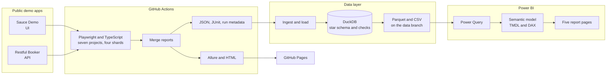

# Power BI Dashboard for Playwright

[](https://github.com/JordyRdev/powerbi-playwright-dashboard/actions/workflows/ci.yml)
[](https://JordyRdev.github.io/powerbi-playwright-dashboard/)
[](LICENSE)

A Playwright and TypeScript suite runs in GitHub Actions, stores every run in a star schema, and opens as a Power BI report. The report shows which tests are flaky, whether the suite is getting slower, and whether a release is better or worse than the one before it.

Phase 4 of 6 is on `main`. The semantic model and the five report pages live in `powerbi/Quality.pbip`. Every CI run on `main` is added to the [`data` branch](https://github.com/JordyRdev/powerbi-playwright-dashboard/tree/data). Refresh the project in Power BI Desktop to load the current files. Screenshots of the report pages are not in the repository yet. See [Screenshots](#screenshots).

The live Allure report: <https://jordyrdev.github.io/powerbi-playwright-dashboard/>


The test suite started in [playwright-typescript-portfolio](https://github.com/JordyRdev/playwright-typescript-portfolio) and continues here.

## Why this project

Teams run large suites and still cannot answer three questions:

- Which tests are flaky?
- Is the suite getting slower?
- Is this release better or worse than the last one?

This repository answers them with runs against public demo apps. Playwright produces the results. A small pipeline turns those results into a star schema. Power BI is the report on top of that schema.

## Architecture



Playwright runs in CI against [Sauce Demo](https://www.saucedemo.com) and [Restful Booker](https://restful-booker.herokuapp.com). The merge job writes `playwright-results.json`, `junit.xml`, and `run-meta.json`. The pipeline stores each run, validates it, and rebuilds a DuckDB star schema. If every check passes, it writes Parquet and CSV on the `data` branch. Power Query loads the nine CSV files into `powerbi/Quality.pbip`. The report pages read the DAX measures on that model.

Design notes and the full diagram are in [docs/architecture.md](docs/architecture.md). The tables, grain, and checks are in [docs/data-model.md](docs/data-model.md).

## Repository

| Area         | What is here                                                                        |
| ------------ | ----------------------------------------------------------------------------------- |
| UI tests     | Sauce Demo: login, sorting, cart, checkout (page objects and fixtures)              |
| API tests    | Restful Booker: auth, booking CRUD, contract checks with Zod                        |
| Visual tests | Four pages. Baselines are valid inside the official Playwright image                |
| Projects     | `api`, `chromium`, `firefox`, `webkit`, `mobile-chrome` (Pixel 5), `visual`, `demo` |
| Tooling      | TypeScript (strict), ESLint with Playwright rules, Prettier, EditorConfig           |
| Docker       | `Dockerfile` on the official Playwright image, same version as `@playwright/test`   |
| CI           | Lint, four sharded jobs, merged reports, GitHub Pages, three scheduled runs a day   |
| Data         | DuckDB star schema, 19 checks, Parquet and CSV on the `data` branch                 |
| Power BI     | `powerbi/Quality.pbip`: Power Query, a TMDL model, DAX measures, five pages         |

```text
tests/ui            login, sorting, cart, checkout
tests/api           auth, booking CRUD, contract checks
tests/visual        screenshot comparison (baselines in __screenshots__)
tests/demo          the labelled demo flaky test
pipeline/           ingest, load, DuckDB build, SQL (staging, dims, facts, checks)
powerbi/            Quality.pbip, semantic model (TMDL), report pages
scripts/            publish-data.sh updates the data branch
src/pages           page objects
src/fixtures        shopper and API fixtures
src/api             HTTP client and Zod schemas
src/data            users, catalog, customer, booking builder
src/support         checkout total and the demo flaky helper
src/config          public demo URLs
docs/               architecture, CI, visual testing, data model, Power BI
Dockerfile          official Playwright image, same version as package.json
merge.config.ts     merges shard reports into HTML, JSON, and JUnit
allurerc.mjs        Allure report, history, and failure categories
.github/workflows   CI, visual baseline update, dataset backfill
```

## Run the tests

Requires Node.js 22 (`.nvmrc`). `package.json` allows 22 or newer.

```bash
npm ci
npx playwright install --with-deps
npm test               # API, UI, visual, and demo
npm run test:smoke     # only @smoke
npm run test:regression
npm run test:api       # API only, no browser needed
npm run test:visual    # screenshot asserts run in CI and Docker only
npm run test:chromium  # API plus Chromium
npm run lint           # ESLint and Prettier
npm run typecheck
npm run report         # open the last HTML report
npm run report:allure  # build and open Allure from allure-results/
npm run test:pipeline  # pipeline and model checks, no browser
```

The targets are public practice systems. Values in `.env.example` are the published demo accounts, not secrets. Copy it to `.env` only if you want to point the suite somewhere else.

A local `npm test` writes the HTML report and Allure results. The JSON, JUnit, and `run-meta.json` files the dataset is built from come from the CI merge job.

### Docker

```bash
npm run docker:build
npm run docker:test    # writes playwright-report/ and test-results/ on your machine
```

The image uses the same Playwright version as `package.json`, so browsers and fonts match CI. That is what keeps the visual baselines stable. See [docs/visual-testing.md](docs/visual-testing.md).

### The demo flaky test

`tests/demo/demo-flaky.spec.ts` is flaky on purpose and is tagged `@demo-flaky`. The default `DEMO_FLAKY_RATE` is `0.3`. The test can fail only on the first attempt, and only when the project retries, so the final status is `flaky`. Local runs do not retry, so the test passes locally. Leave it out with `--grep-invert @demo-flaky`.

The report has measures that exclude this test, and a Demo test slicer on every page.

## Generate the dataset

```text
raw-results → raw/<run_id>/ → staging (TypeScript and Zod) → DuckDB SQL → checks → Parquet and CSV
```

Two facts and seven dimensions are written as files: `fact_test_result` (one test, one project, one run) and `fact_run`, with test, project, environment, release, commit, date, and failure category. Each run is labelled with the latest Git tag reachable from the commit it tested. The model is rebuilt from the raw archive, so storing a run twice does not change the output. `npm run test:pipeline` covers that.

`pipeline/sql/99_checks.sql` runs 19 checks (unique grain, orphan keys, totals that match Playwright and JUnit, and more). One failure and nothing is written.

On `main`, the CI job Update dataset adds the run and rebuilds the branch. Actions, Backfill dataset, adds earlier runs from artifacts kept for 90 days.

To rebuild from a downloaded `raw-results` folder (it must contain `run-meta.json`):

```bash
npm run data:ingest -- --raw .data/raw path/to/raw-results
npm run data:build -- --raw .data/raw --out .data/model
```

The same build CI uses, without pushing:

```bash
PUSH=false bash scripts/publish-data.sh path/to/raw-results
```

Details: [docs/data-model.md](docs/data-model.md).

## Open the report in Power BI Desktop

`powerbi/Quality.pbip` opens in Power BI Desktop on Windows. You open and refresh the file there yourself.

1. Install [Power BI Desktop](https://www.microsoft.com/power-bi) (current version).
2. Clone this repository.
3. Choose **File, Open, Browse** and select `powerbi/Quality.pbip`. Desktop opens the report and the semantic model together. The first open can take a minute while Desktop reads the TMDL files.
4. Choose **Home, Refresh**.

The default parameter `p Source Mode` is `GitHub`. Refresh reads the public CSV files on the `data` branch through the Web connector, with no sign in and no gateway:

```text
https://raw.githubusercontent.com/JordyRdev/powerbi-playwright-dashboard/data/model/csv/<table>.csv
```

Parquet copies of the same tables sit next to the CSV files. The project loads CSV so column types are set in M.

If Desktop asks for a privacy level, choose **Public** for the Web source.

To load a folder you built with `npm run data:build`, set `p Source Mode` to `Local` and point `p Local Folder` at `model/csv`, the folder that contains the nine CSV files. The default local path is `C:\quality-data\csv`. Edit the parameters from **Home, Transform data, Edit parameters**.

The semantic model is the star schema. Both facts share the date, release, commit, environment, and trigger dimensions, and they stay separate from each other. Relationships are many to one and filter from the dimension into the fact. Keys are hidden. `dim_date` is the date table on the `Date` column, and automatic date tables are off. `dim_trigger` is calculated from the distinct triggers on `fact_run`, so a trigger slicer filters both facts. The `Metrics` table holds the measures.

`npm run test:pipeline` checks that CSV columns, DAX references, and visual bindings name real columns and measures. Refreshing the file in Desktop remains a manual step.

Refresh, privacy, and the service publish notes are in [docs/power-bi.md](docs/power-bi.md).

## Report pages

The page order is Overview, Flaky tests, Duration trends, Release comparison, Failure patterns. Every page has the same five slicers, kept in sync: Date, Project, Release, Demo test, and Test type.

| Page               | What it shows                                                                                                                                                        |
| ------------------ | -------------------------------------------------------------------------------------------------------------------------------------------------------------------- |
| Overview           | Pass rate, fail rate, flaky rate, flaky test count, runs, tests, average duration, p90, and the change against the previous period. Pass rate by day and by project. |
| Flaky tests        | Flaky rate with and without the demo test, demo flaky results, flaky rate by test, a test table, and flaky rate by day.                                              |
| Duration trends    | Average, p90, median, and total duration, the duration change, and wall clock. Duration by day and by project, and wall clock by day.                                |
| Release comparison | Pass rate, fail rate, flaky rate, and the change against the previous release. A release table and a commit table with the change from the previous commit.          |
| Failure patterns   | Failure results by category, the normalised message, and failures by day and by project. Category `none` is a pass.                                                  |

Cards use the measure name as their label.

## Key measures

Rates follow [docs/data-model.md](docs/data-model.md). The measures live in the `Metrics` table.

- **Executed** is passed, flaky, and failed. Skipped results are left out.
- **Pass rate** is (passed + flaky) / executed. A flaky result counts as passed, because the final attempt passed.
- **Fail rate** is failed / executed.
- **Flaky rate** is flaky / executed.
- **Flaky test count** is the number of distinct tests with at least one flaky result. **Flaky** counts flaky rows, so it is larger when one test flakes more than once.
- **Average duration (s)** and **P90 duration (s)** use the final attempt. Skipped rows are left out. **P90 duration (s)** uses the inclusive percentile. **Total duration (s)** includes retries.
- **Previous period** is the same number of calendar days immediately before the first selected date. With every day selected, the comparison measures are blank.
- **Previous release** is the release whose `release_order` is one lower. `untagged` is order 0, so it has no previous release until a tag exists.
- **Previous commit** is the commit with the latest `Committed at` strictly before the current one. It is blank when more than one commit is in context.
- Measures that exclude the demo test, plus smoke pass rate, retry rate, failure share, wall clock, and workflow failures, are in the same table.

A named snapshot and the full measure list are in [docs/power-bi.md](docs/power-bi.md). Later runs on `main` add rows, so a refresh will not match that snapshot. The definitions above are what stay fixed.

## Screenshots

The five report pages do not have images in this repository yet. Each block below is a placeholder. Replace the text with a screenshot from Power BI Desktop. Do not treat the text as a picture.

### Overview

`[PLACEHOLDER: Overview page of powerbi/Quality.pbip]`

### Flaky tests

`[PLACEHOLDER: Flaky tests page of powerbi/Quality.pbip]`

### Duration trends

`[PLACEHOLDER: Duration trends page of powerbi/Quality.pbip]`

### Release comparison

`[PLACEHOLDER: Release comparison page of powerbi/Quality.pbip]`

### Failure patterns

`[PLACEHOLDER: Failure patterns page of powerbi/Quality.pbip]`

## Reports and CI

- **Allure report:** <https://JordyRdev.github.io/powerbi-playwright-dashboard/> with trends across runs and failure categories (visual, network, locator, timeout, assertion).
- **Playwright HTML report:** <https://JordyRdev.github.io/powerbi-playwright-dashboard/playwright/>
- **Raw results:** every CI run keeps a `raw-results` artifact for 90 days (`playwright-results.json`, `junit.xml`, `run-meta.json`).
- **Dataset:** the `data` branch holds every run on `main` and the star schema built from it, as Parquet and CSV.

CI runs on every push and pull request, and at 05:23, 11:23, and 17:23 UTC every day. Tests run in four shards inside the official Playwright image. The blob reports are merged into one report. Runs on `main` update the dataset even when tests fail, because failures are data too. Details: [docs/ci.md](docs/ci.md).

## Roadmap

| Phase                | Scope                                                                                                                    | Status   |
| -------------------- | ------------------------------------------------------------------------------------------------------------------------ | -------- |
| 1. Setup             | New repo, suite carried over, Docker, lint and format, first green CI                                                    | Done     |
| 2. Test suite and CI | Visual tests in Docker, `@smoke` and `@regression` tags, sharded jobs, merged reports, Allure on Pages, schedule, `v1.0` | Done     |
| 3. Data pipeline     | JSON reporter, loader, DuckDB star schema, data quality checks, Parquet on a `data` branch                               | Done     |
| 4. Power BI          | Power Query (M), semantic model and relationships, DAX measures, report pages, saved as PBIP and TMDL                    | Done     |
| 5. Presentation      | Dashboard screenshots, short demo video, case study                                                                      | Planned  |
| 6. Optional          | JMeter load test on Restful Booker, failure clustering in SQL, Microsoft Fabric Lakehouse variant                        | Optional |

## Test strategy

- **Risk first.** Each test protects a decision a user or a client system can get wrong.
- **Pyramid.** API tests carry the data rules (status codes, auth, payload shape). UI tests cover what only a browser can show.
- **Smoke first.** `@smoke` marks the checks that decide whether the shop and the API are usable at all. `@regression` is everything else.
- **No hidden flakiness.** Local runs do not retry. CI retries twice, and Playwright marks a test that only passed on retry as `flaky`. That status is what the dashboard measures.
- **Nothing skipped.** `playwright/no-skipped-test` is an error, and CI sets `forbidOnly`.
- **Evidence on failure.** Trace, screenshot, and video are kept when a test fails.

## Author

[@JordyRdev](https://github.com/JordyRdev): QA and data quality, test automation and business intelligence.

## License

[MIT](LICENSE)
