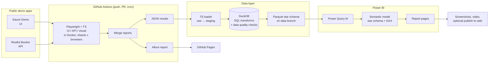

# Power BI Dashboard for Playwright

[](https://github.com/JordyRdev/powerbi-dashboard-playwright/actions/workflows/ci.yml)
[](https://JordyRdev.github.io/powerbi-dashboard-playwright/)
[](LICENSE)

A Playwright + TypeScript suite that runs in parallel on GitHub Actions, stores every run in a star schema, and turns it into a Power BI dashboard: flaky tests, duration trends, pass rate per release and failure patterns.

> **Status:** phase 3 of 6 (data pipeline) is done. Every CI run on `main` is added to a star schema of Parquet files on the [`data` branch](https://github.com/JordyRdev/powerbi-dashboard-playwright/tree/data), checked for data quality on the way. The Power BI dashboard comes next. See the [roadmap](#roadmap).


The live report: https://jordyrdev.github.io/powerbi-dashboard-playwright/

## Why this project

Teams run thousands of tests, but few can answer three simple questions:

- Which tests are flaky?
- Is the suite getting slower?
- Is this release better or worse than the last one?

This repository answers them with real data. A Playwright suite runs in CI against public demo apps. Every run is loaded into a small star schema, and Power BI turns that into a quality dashboard. It brings test automation and business intelligence together in one project.

The test suite started in [playwright-typescript-portfolio](https://github.com/JordyRdev/playwright-typescript-portfolio) and continues here.

## Architecture



More detail and the design decisions are in [docs/architecture.md](docs/architecture.md).

## What is in the repo today

| Area      | Contents                                                                       |
| --------- | ------------------------------------------------------------------------------ |
| UI tests  | Sauce Demo: login, sorting, cart, checkout (Page Object Model, fixtures)       |
| API tests | Restful Booker: auth, booking CRUD, contract checks with Zod                   |
| Browsers  | Chromium, Firefox, WebKit and a Pixel 5 viewport                               |
| Tooling   | TypeScript (strict), ESLint with Playwright rules, Prettier, EditorConfig      |
| Docker    | `Dockerfile` on the official Playwright image, pinned to the same version      |
| CI        | Lint, 4 sharded test jobs in the Playwright image, merged reports, Pages, cron |
| Reports   | Allure and Playwright HTML on GitHub Pages; JSON + JUnit kept as artifacts     |
| Data      | DuckDB SQL builds a star schema with quality checks; Parquet + CSV on `data`   |

```text
tests/ui            login, sorting, cart, checkout
tests/api           auth, booking CRUD, contract checks
tests/visual        screenshot comparison (baselines in __screenshots__)
tests/demo          the labelled demo flaky test
pipeline/           ingest, load (Zod), DuckDB build and SQL (staging, dims, facts, checks)
scripts/            publish-data.sh: updates the data branch
src/pages           page objects
src/fixtures        shopper and API fixtures
src/api             HTTP client and Zod schemas
src/data            users, catalog, customer, booking builder
src/support         checkout total rule
docs/               architecture, CI pipeline, visual testing, data model
Dockerfile          test image on mcr.microsoft.com/playwright
merge.config.ts     merges shard reports into HTML, JSON and JUnit
allurerc.mjs        Allure 3 report, history and failure categories
.github/workflows   CI and the visual baseline update
```

## Run locally

Requires Node.js 22.

```bash
npm ci
npx playwright install --with-deps
npm test               # everything: API, UI on four browsers, visual, demo
npm run test:smoke     # only @smoke
npm run test:regression
npm run test:api       # API only, no browser needed
npm run test:visual    # visual project (screenshots are compared in CI and Docker only)
npm run test:chromium  # API + Chromium, the quickest full check
npm run lint           # ESLint and Prettier
npm run typecheck      # tsc --noEmit
npm run report         # open the last HTML report
npm run report:allure  # build and open an Allure report from allure-results/
npm run test:pipeline  # unit tests for the data pipeline (no browser needed)
```

The targets are public practice systems. Credentials in `.env.example` are the published demo accounts, not secrets. Copy it to `.env` only if you want to point the suite somewhere else.

### Run in Docker

```bash
npm run docker:build
npm run docker:test    # writes playwright-report/ and test-results/ to your machine
```

The image uses the same Playwright version as `package.json`, so browsers and fonts are identical locally and in CI. That is what keeps the visual baselines reliable; see [docs/visual-testing.md](docs/visual-testing.md).

## Reports and CI

- **Allure report:** <https://JordyRdev.github.io/powerbi-dashboard-playwright/> with trends across runs and failure categories (visual, network, locator, timeout, assertion).
- **Playwright HTML report:** <https://JordyRdev.github.io/powerbi-dashboard-playwright/playwright/>
- **Raw results:** every CI run keeps a `raw-results` artifact for 90 days with `playwright-results.json`, `junit.xml` and `run-meta.json`.
- **Dataset:** the `data` branch holds every run on `main` and the star schema built from it, as Parquet and CSV. See [docs/data-model.md](docs/data-model.md).

CI runs on every push and pull request, and at 05:23, 11:23 and 17:23 UTC every day. Tests run in four shards inside the official Playwright image, and the blob reports are merged into one report. Details: [docs/ci.md](docs/ci.md).

### The demo flaky test

`tests/demo/demo-flaky.spec.ts` is flaky **on purpose** and is tagged `@demo-flaky`. In CI it fails on about 30% of first attempts and always passes on the retry, so Playwright reports it as `flaky`. It gives the dashboard a known example of flakiness to show. It never fails locally, and you can leave it out with `--grep-invert @demo-flaky`.

## Data pipeline

```text
raw-results → raw/<run_id>/ → staging (TypeScript + Zod) → DuckDB SQL → checks → Parquet/CSV
```

- **Two facts, seven dimensions:** `fact_test_result` (one test × project × run) and `fact_run`, with test, project, environment, release, commit, date and failure category.
- **Releases from Git:** each run is labelled with the latest tag reachable from the commit it tested.
- **Data quality gate:** 19 checks (unique grain, orphan keys, totals that match Playwright and JUnit, and more). One failure and nothing is written.
- **Idempotent:** the model is rebuilt from the raw archive, so storing a run twice changes nothing; this is unit tested.
- **Automatic:** the CI job _Update dataset_ adds every run on `main`; _Backfill dataset_ adds earlier runs from their artifacts.

Details, ER diagram and metric definitions: [docs/data-model.md](docs/data-model.md).

## Roadmap

| Phase              | Scope                                                                                                              | Status   |
| ------------------ | ------------------------------------------------------------------------------------------------------------------ | -------- |
| 1. Setup           | New repo, suite carried over, Docker, lint and format, first green CI                                              | Done     |
| 2. Test suite + CI | Visual tests in Docker, `@smoke`/`@regression` tags, sharded matrix, merged reports, Allure on Pages, cron, `v1.0` | Done     |
| 3. Data pipeline   | JSON reporter, loader, DuckDB SQL to a star schema, data quality checks, Parquet on a `data` branch                | Done     |
| 4. Power BI        | Power Query (M), semantic model and relationships, DAX measures, report pages, saved as PBIP/TMDL in Git           | Next     |
| 5. Presentation    | Dashboard screenshots, short demo video, case study                                                                | Planned  |
| 6. Optional        | JMeter load test on Restful Booker, failure clustering in SQL, Microsoft Fabric Lakehouse variant                  | Optional |

## Test strategy (short)

- **Risk first.** Each test protects a decision a user or a client system can get wrong.
- **Pyramid.** API tests carry the data rules (status codes, auth, payload shape). UI tests cover what only a browser can show.
- **Smoke first.** `@smoke` marks the handful of checks that decide whether the shop and the API are usable at all; `@regression` is everything else.
- **No hidden flakiness.** Local runs do not retry. CI retries twice, and Playwright marks a test that only passed on retry as `flaky`. That status is what the dashboard will measure.
- **Nothing skipped.** `playwright/no-skipped-test` is an error and CI sets `forbidOnly`.
- **Evidence on failure.** Trace, screenshot and video are kept when a test fails.

## Author

[@JordyRdev](https://github.com/JordyRdev): QA and data quality, test automation and business intelligence.

## License

[MIT](LICENSE)
