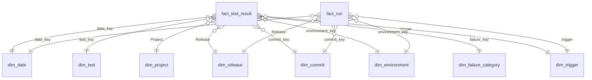

# Power BI

`powerbi/Quality.pbip` is the phase 4 report. It loads the star schema from the
[`data` branch](https://github.com/JordyRdev/powerbi-playwright-dashboard/tree/data)
and answers the questions in the README: which tests are flaky, whether the suite
is getting slower, and whether a release is better or worse than the one before it.

Power BI Desktop is not part of this repository's CI (the agents run on Linux).
The model was checked with the Analysis Services TMDL parser, the report JSON was
checked against Microsoft's PBIR schemas, and the measure logic was reproduced in
DuckDB against a named snapshot. Opening the file and refreshing it is still a
manual step. That check, and the screenshots, are listed at the end.

## Open the project

1. Install [Power BI Desktop](https://www.microsoft.com/power-bi) (current version, Windows).
2. Clone this repository.
3. In Desktop, use **File, Open, Browse** and choose `powerbi/Quality.pbip`.
   Desktop opens the report and the semantic model together.

The first open can take a minute while Desktop reads the TMDL files.

## Where the data comes from

Power Query loads nine CSV files. The default is the public raw URL of the `data`
branch, so a refresh needs no gateway and no sign in:

```text
https://raw.githubusercontent.com/JordyRdev/powerbi-playwright-dashboard/data/model/csv/<table>.csv
```

The host is a fixed string. The file name is passed as `RelativePath`, which is the
pattern the Power BI service can refresh. Parquet copies of the same tables sit next
to the CSV files. CSV is what the project uses, because the column types are set in
M and do not depend on what a Parquet reader infers.

Two parameters (Home, **Transform data**, **Edit parameters**):

| Parameter        | Default               | Meaning                                                                                                                                                         |
| ---------------- | --------------------- | --------------------------------------------------------------------------------------------------------------------------------------------------------------- |
| `p Source Mode`  | `GitHub`              | `GitHub` reads the URL above. `Local` reads a folder on this PC.                                                                                                |
| `p Local Folder` | `C:\quality-data\csv` | Used only when Source Mode is `Local`. Point it at the folder that contains the nine CSV files (`model/csv` from a local build, not the `model` folder itself). |

Leave Source Mode on `GitHub` unless you are loading a folder you built with
`npm run data:build`.

### Refresh in Desktop

**Home, Refresh.**

Desktop may ask you to approve a native query or to set a privacy level. Choose
**Public** for the Web source. If it also mentions a file source, choose **Public**
for that too, or turn on **Ignore privacy levels** for this file (File, Options,
**Privacy**). Both branches live in one function so you can switch with a parameter.
Power Query sometimes wants a privacy level for the branch you are not using.

Timestamps in the CSV look like `2026-10-31 20:31:29.114+00`. The queries strip the
offset and keep the clock time as UTC, which is how the pipeline writes them.
Dates are parsed as `yyyy-MM-dd`.

### Refresh in the Power BI service

Publish with Source Mode still set to `GitHub`.

1. In the service, open the semantic model settings.
2. **Data source credentials**, the Web source: **Anonymous**, privacy **Public**.
3. Refresh.

No gateway is required for that Web source. The local folder branch is still in
the M code, so the service may also list a file source and ask for a gateway.
If it does, the GitHub path is still the one that should refresh. If the service
refuses the whole refresh because of the file branch, that is a limit of having
both modes in one function. Desktop refresh is the path this project is built
around. Confirming the service refresh is a manual check.

## The model



Every relationship is many to one and filters in one direction, from the dimension
into the fact. Keys are hidden. `dim_date` is marked as a date table on the `Date`
column (type date, format `dd/MM/yyyy`). Automatic date tables are turned off.

`fact_test_result` is one test on one project in one run. `fact_run` is one CI run.
They share the date, release, commit, environment and trigger dimensions. There is
no relationship between the two facts. A direct link as well as the shared
dimensions would give two filter paths, and Power BI would treat that as ambiguous.
On every row the run's date, release, commit and environment keys match the run
row (checked on the snapshot: no mismatches), so filtering through the dimensions
is the same as filtering through the run.

`dim_trigger` is not a CSV file. It is `DISTINCT` of `fact_run[Trigger]`, and the
test result fact copies trigger with `LOOKUPVALUE`, so a trigger slicer filters
both facts. `Metrics` only holds measures. Its one column is hidden.

In Model view, **All tables** places the two facts in the middle and the dimensions
around them.

Columns you will use on the report keep plain names (`Date`, `Project`, `Release`,
`Title path`, `Category`, `Normalised message`). The CSV names stay as the source
columns. `Normalised message` is the British name of the column `normalized_message`.

## Measures

Rates use the definitions in [data-model.md](data-model.md).

- **Executed** is passed + flaky + failed. Skipped results are left out.
- **Pass rate** = (passed + flaky) / executed. A flaky result counts as passed, because the final attempt passed.
- **Fail rate** = failed / executed.
- **Flaky rate** = flaky / executed.
- **Flaky test count** is the number of distinct tests with at least one flaky result. **Flaky** is the number of flaky rows, which is larger when one test flakes more than once.
- **Duration** measures use the final attempt (`Duration (ms)`), converted to seconds. Rows with status `skipped` are left out, so a skip does not pull the average down. There are no skipped rows in the snapshot, so the exclusion does not change these numbers.
- **P90 duration (s)** uses `PERCENTILEX.INC` (the inclusive percentile, the same method as Excel `PERCENTILE.INC` and DuckDB `quantile_cont`).
- **Total duration (s)** sums `Total duration (ms)`, which includes retries.
- **Previous period** is the same number of calendar days immediately before the first selected date. With every day selected, that window is before the first run, so the comparison measures are blank. That is the correct result, not a missing relationship.
- **Previous release** is the release whose `release_order` is one lower. `untagged` is order 0, so it has no previous release until a tag exists.
- **Previous commit** is the commit with the latest `Committed at` strictly before the current one. It is blank on a card that has more than one commit in context. It has a value on each row of the commit table.

Measures that are not in the data model doc, and what they add:

| Measure                                                                                                        | What it adds                                                   |
| -------------------------------------------------------------------------------------------------------------- | -------------------------------------------------------------- |
| Pass rate (excluding demo), Flaky rate (excluding demo), Flaky test count (excluding demo), Demo flaky results | The labelled `@demo-flaky` test, taken out or shown on its own |
| Smoke pass rate                                                                                                | Pass rate for tests tagged smoke                               |
| Retry rate                                                                                                     | Share of executed results with at least one retry              |
| Median duration (s), Total duration (s)                                                                        | Middle duration, and time spent including retries              |
| Pass rate previous period, Pass rate vs previous period                                                        | The same window logic as duration, for pass rate               |
| Average duration previous release (s), Duration change vs previous release                                     | Whether the suite got slower from one release to the next      |
| Pass rate previous commit, Pass rate vs previous commit                                                        | A comparison you can read while there is only one release      |
| Failure results, Share of failures                                                                             | Failed + flaky rows, and each category's share of them         |
| CI runs, Average wall clock (s), Workflow failures                                                             | Run grain. A test or project slicer does not change these      |
| Latest run pass rate                                                                                           | Pass rate of the newest run in the filter, by start time       |

**Runs** counts distinct runs on the test result fact, so it follows test and project filters. **CI runs** counts `fact_run` and does not. On the snapshot below every test is present in every run, so both stay at 35 even after a project slicer.

Percentage point measures (anything named "vs") are a difference of two rates, formatted as a percentage. A change of 0.01 is shown as 1.00%.

## Report pages

The canvas is 1280 by 720. Every page has the same five slicers, kept in sync: Date, Project, Release, Demo test, Test type. The page background is a light grey.

| Page               | What it shows                                                                                                                                       |
| ------------------ | --------------------------------------------------------------------------------------------------------------------------------------------------- |
| Overview           | Pass rate, fail rate, flaky rate, flaky test count, runs, duration, p90, and the two previous period comparisons. Pass rate by day and by project.  |
| Flaky tests        | Flaky rate with and without the demo test, flaky rate by test, a test table, flaky rate by day.                                                     |
| Duration trends    | Average, p90, median, total duration, the duration change, and wall clock. Duration by day (average and p90), by project, and wall clock by day.    |
| Release comparison | Pass rate against the previous release, a release table, and a commit table with the change from the previous commit.                               |
| Failure patterns   | Failure results by category, the normalised message, failures by day and by project. Category `none` is a pass. The failure measure is blank there. |

Cards use the measure name as their label. Charts and tables have their own titles.

## Expected values

These numbers match the `data` branch commit `fee8493853c7bfab058c19a98db2f5ca03454546`
(`chore(data): update dataset (35 runs)`, built at `2026-10-31T20:33:59.604Z`).
Later runs on `main` add rows, so a refresh after that commit will not match this
table. The definitions are what should still match. To reproduce the table, check
out that commit of the `data` branch, or read the CSV files from it.

Clear every slicer before reading the cards. The card column is the format string
in the model (`0.00%` or `0.000`). The value column is the full number, which you
can see in **DAX query view**.

| Measure                           | Value                                      | Card      |
| --------------------------------- | ------------------------------------------ | --------- |
| Test results                      | 1750                                       | 1,750     |
| Passed                            | 1737                                       | 1,737     |
| Failed                            | 4                                          | 4         |
| Flaky                             | 9                                          | 9         |
| Skipped                           | 0                                          | 0         |
| Executed                          | 1750                                       | 1,750     |
| Tests                             | 23                                         | 23        |
| Runs                              | 35                                         | 35        |
| CI runs                           | 35                                         | 35        |
| Pass rate                         | 1746 / 1750 = 0.9977142857                 | 99.77%    |
| Fail rate                         | 4 / 1750 = 0.0022857143                    | 0.23%     |
| Flaky rate                        | 9 / 1750 = 0.0051428571                    | 0.51%     |
| Flaky test count                  | 1                                          | 1         |
| Average duration (s)              | 1.0526954286                               | 1.053     |
| P90 duration (s)                  | 1.939                                      | 1.939     |
| Median duration (s)               | 0.972                                      | 0.972     |
| Total duration (s)                | 1842.313                                   | 1,842.313 |
| Retry rate                        | 9 / 1750 = 0.0051428571                    | 0.51%     |
| Pass rate (excluding demo)        | 1711 / 1715 = 0.9976676385                 | 99.77%    |
| Flaky rate (excluding demo)       | 0                                          | 0.00%     |
| Flaky test count (excluding demo) | 0                                          | 0         |
| Demo flaky results                | 9                                          | 9         |
| Smoke pass rate                   | 1                                          | 100.00%   |
| Average wall clock (s)            | 24.4586285714                              | 24.459    |
| Workflow failures                 | 1                                          | 1         |
| Latest run pass rate              | 1 (run 41239134384, 49 passed and 1 flaky) | 100.00%   |
| Pass rate previous period         | blank                                      | blank     |
| Pass rate vs previous period      | blank                                      | blank     |
| Duration change                   | blank                                      | blank     |
| Pass rate previous release        | blank                                      | blank     |
| Pass rate vs previous release     | blank                                      | blank     |

P90 is the inclusive percentile of 1750 durations. The rank is `0.9 * 1749 = 1574.1`, between 1938 ms and 1948 ms, which lands on 1939 ms. DuckDB `quantile_cont(duration_ms, 0.9)` returns the same 1939. The median is 972 ms (both central values are 972).

### Previous period, with a date filter

Set the Date slicer to 26/10/2026 through 31/10/2026 (six days). The previous period is 20/10/2026 through 25/10/2026.

| Measure              | Selected six days | Previous six days     | Change                                  |
| -------------------- | ----------------- | --------------------- | --------------------------------------- |
| Executed             | 800               | 950                   |                                         |
| Pass rate            | 1                 | 0.9957894737 (99.58%) | +0.0042105263, card +0.42%              |
| Fail rate            | 0                 | 0.0042105263          |                                         |
| Flaky rate           | 0.00375 (0.38%)   | 0.0063157895          |                                         |
| Flaky                | 3                 | 6                     |                                         |
| Failed               | 0                 | 4                     |                                         |
| Runs                 | 16                | 19                    |                                         |
| Average duration (s) | 1.04710125        | 1.0574063158          | -0.0103050658 s, relative change -0.97% |

The minus signs in that last cell are the arithmetic result (the suite was slightly faster), not a punctuation dash.

### Releases and commits

There is one release, `untagged`, with `release_order` 0. Previous release measures stay blank on the card and on that row.

Commit pass rates, oldest first. "Vs previous" is blank on the first commit.

| Commit  | Committed at (UTC)  | Results | Pass rate | Vs previous |
| ------- | ------------------- | ------- | --------- | ----------- |
| 0fc3f5d | 2026-10-20 17:09:28 | 50      | 92.00%    | blank       |
| 4e4545f | 2026-10-20 17:18:56 | 50      | 100.00%   | +8.00%      |
| 49f30f6 | 2026-10-20 17:34:54 | 1200    | 100.00%   | 0.00%       |
| 60c97a6 | 2026-10-29 06:05:23 | 50      | 100.00%   | 0.00%       |
| 165668e | 2026-10-29 06:37:49 | 400     | 100.00%   | 0.00%       |

### Failures and projects

Failure results = 13. By category: assertion 9 (all flaky, share 69.23%), visual diff 4 (all failed, share 30.77%).

Pass rate by project is 100% except `visual` at 97.14% (4 failed out of 140, average duration 1.136 seconds). The `demo` project has pass rate 100% and flaky rate 25.71% (9 of 35). Filter Project to `visual` and the wall clock card stays 24.459 seconds, because wall clock does not follow the project slicer. Average duration moves to about 1.136 seconds.

A query you can paste into DAX query view, with slicers cleared:

```dax
EVALUATE
ROW (
    "Pass rate", [Pass rate],
    "Fail rate", [Fail rate],
    "Flaky rate", [Flaky rate],
    "Flaky test count", [Flaky test count],
    "Average duration (s)", [Average duration (s)],
    "P90 duration (s)", [P90 duration (s)],
    "Runs", [Runs],
    "Tests", [Tests]
)
```

The same definitions in DuckDB, against `model/csv`:

```sql
SELECT
  count(*) FILTER (WHERE status = 'passed') AS passed,
  count(*) FILTER (WHERE status = 'failed') AS failed,
  count(*) FILTER (WHERE status = 'flaky') AS flaky,
  (count(*) FILTER (WHERE status IN ('passed', 'flaky'))) * 1.0
    / count(*) FILTER (WHERE status <> 'skipped') AS pass_rate,
  avg(duration_ms) / 1000 AS avg_duration_s,
  quantile_cont(duration_ms, 0.9) / 1000 AS p90_duration_s
FROM read_csv('fact_test_result.csv');
```

## What to finish in Desktop

The files are complete enough to open, but these steps need Power BI Desktop and were not run here:

1. Open `powerbi/Quality.pbip` and refresh on Source Mode `GitHub`. Confirm the nine tables load and the relationships stay one direction.
2. With slicers cleared, compare the overview cards with the table above. Then set the date slicer to the six days and check the previous period cards.
3. Click through all five pages. A visual with a wrong field well would be empty. The page tab still names the page if a title text box does not render.
4. If you want the failure message table to hide category `none`, add a visual filter `Category is not none`.
5. Publish only if you want the service check, with Source Mode left on `GitHub`, and note whether a gateway was requested.
6. Screenshots and a short demo are phase 5. They are not in this change.

`npm run test:pipeline` checks that every CSV column the pipeline writes is in the model, that every DAX reference and every visual binding names a real column or measure, and that the date table and the relationship direction are set. It does not refresh Power BI, and it does not lock the expected numbers, because the `data` branch gains a run whenever `main` is tested.
